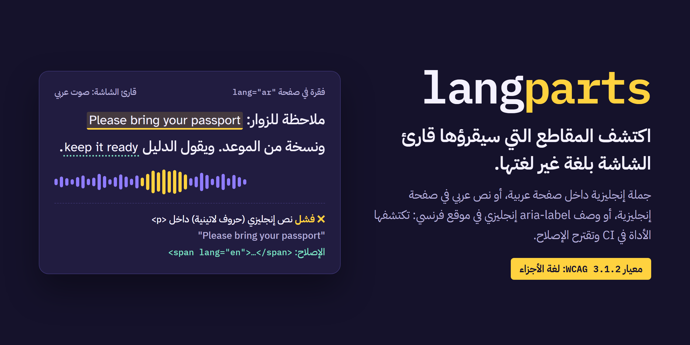
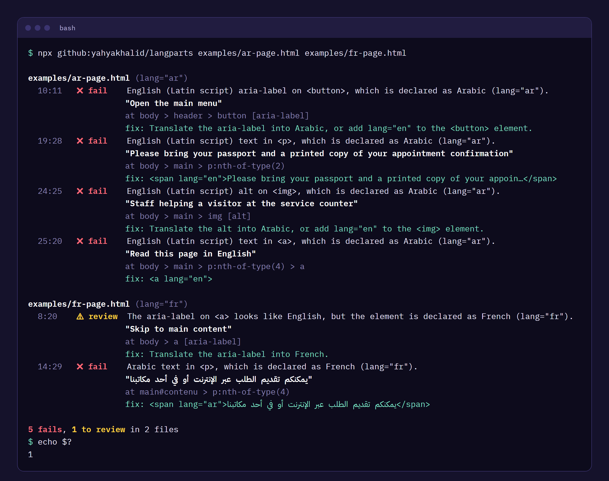

<div dir="rtl">

<p align="center">
  
</p>

<p align="center">
  <a href="https://github.com/yahyakhalid/langparts/actions/workflows/ci.yml"></a>
  <a href="LICENSE"></a>
  
  <a href="docs/experiment.md#corpus-b-real-pages"></a>
  
</p>

<p align="center"><a href="README.md">English</a> · <b>العربية</b></p>

<p align="center">
  <a href="https://github.com/topics/accessibility"><code>#accessibility</code></a>
  <a href="https://github.com/topics/a11y"><code>#a11y</code></a>
  <a href="https://github.com/topics/wcag"><code>#wcag</code></a>
  <a href="https://github.com/topics/screen-reader"><code>#screen-reader</code></a>
  <a href="https://github.com/topics/i18n"><code>#i18n</code></a>
  <a href="https://github.com/topics/multilingual"><code>#multilingual</code></a>
  <a href="https://github.com/topics/arabic"><code>#arabic</code></a>
  <a href="https://github.com/topics/rtl"><code>#rtl</code></a>
  <a href="https://github.com/topics/html"><code>#html</code></a>
  <a href="https://github.com/topics/linter"><code>#linter</code></a>
  <a href="https://github.com/topics/sarif"><code>#sarif</code></a>
  <a href="https://github.com/topics/github-actions"><code>#github-actions</code></a>
  <a href="https://github.com/topics/cli"><code>#cli</code></a>
  <a href="https://github.com/topics/nodejs"><code>#nodejs</code></a>
</p>

# langparts

**يكتشف النصوص المكتوبة بلغة غير لغة الصفحة دون وسم `lang` صحيح، أي المقاطع التي سيقرؤها قارئ الشاشة بقواعد نطق لغة أخرى. المعيار 3.1.2 «لغة الأجزاء» في WCAG 2.x.**

## المشكلة

قارئ الشاشة يختار الصوت وقواعد النطق بحسب سمة `lang`. فإذا جاءت جملة إنجليزية في صفحة عربية، أو وصف `aria-label` إنجليزي في صفحة فرنسية، دون `lang="en"`، قرأها بقواعد العربية أو الفرنسية فخرجت مشوّهة لا تُفهم. هذا ما يسميه معيار [WCAG 3.1.2 «لغة الأجزاء»](https://www.w3.org/WAI/WCAG22/Understanding/language-of-parts.html) (المستوى AA).

واليوم يُكتشف هذا غالباً بالأذن، بالاستماع إلى قارئ الشاشة:

- وجد تدقيق وصولية حكومي لخدمة تسجيل دخول كندية وصفاً `aria-label` إنجليزياً على رابط في الصفحة الفرنسية، وصنّفه **خطيراً (Serious)، إخفاق في WCAG 3.1.2** ([cds-snc/canadalogin-user-selfservice-webapp#2434](https://github.com/cds-snc/canadalogin-user-selfservice-webapp/issues/2434)، فُتح في 2026-10-27). وفي المستودع نفسه نتائج مشابهة: [#2436](https://github.com/cds-snc/canadalogin-user-selfservice-webapp/issues/2436) و[#2399](https://github.com/cds-snc/canadalogin-user-selfservice-webapp/issues/2399) و[#2384](https://github.com/cds-snc/canadalogin-user-selfservice-webapp/issues/2384) و[#2387](https://github.com/cds-snc/canadalogin-user-selfservice-webapp/issues/2387) و[#2313](https://github.com/cds-snc/canadalogin-user-selfservice-webapp/issues/2313).
- أداة axe-core تتحقق من أن قيم `lang` صالحة (`html-has-lang` و`valid-lang`)، لا من أن النص يطابقها. ومدقق W3C Nu يخمّن لغة الصفحة كلها (المعيار 3.1.1)، لا لغة أجزائها.
- القاعدة موجودة في منتج تجاري: [«Language attribute mismatch»](https://knowledge.evinced.com/system-validations/language-attribute-mismatch) من Evinced، لكنه مغلق ومدفوع.
- وجد تقرير [WebAIM Million 2026](https://webaim.org/projects/million/) أن 13.5% من الصفحات الرئيسية لا تحدد لغة الصفحة أصلاً. أما المعيار 3.1.2 فلا أحد ينشر له رقماً، لأن الأدوات الآلية لا تقيسه.

في البحث الذي سبق هذا المشروع لم نجد أداة مفتوحة المصدر تفحص لغة الأجزاء، وlangparts محاولة لسد هذه الفجوة.

## لمن هذه الأداة

- **فرق المواقع ثنائية اللغة**: عربي/إنجليزي، عربي/كردي، فرنسي/إنجليزي، عبري/إنجليزي، والمواقع الحكومية والجامعية.
- **مدققو الوصولية**، فحصاً أولياً قبل الاستماع بقارئ الشاشة.
- **كل من لديه HTML في CI**: المواقع الثابتة، والتوثيق، وقوالب البريد.

## ماذا تفعل

| | |
|---|---|
| **اختلاف نظام الكتابة ← فشل** | نص بحروف لا تستعملها اللغة المعلَنة: إنجليزي في صفحة عربية، عربي في صفحة إنجليزية، سيريلي، يوناني، عبري، صيني، ياباني، كوري، ديفاناغاري، تايلندي وغيرها |
| **نفس نظام الكتابة ← مراجعة** | إنجليزي في صفحة فرنسية، فارسي أو كردي سوراني في صفحة عربية. لا يُصنَّف فشلاً أبداً |
| **الأسماء لا تُزعج** | `GitHub` و`Visual Studio Code` و`iPhone 15 Pro` و`Bank of America` و`António Guterres` في صفحة عربية لا تظهر في التقرير، لأن WCAG تستثني أسماء العلم |
| **الأسماء الوصفية أيضاً** | `aria-label` و`aria-description` و`alt` و`title` و`placeholder` وقيمة `value` للأزرار، لا النص الظاهر وحده |
| **تتجاوز ما تسمح به WCAG** | الكود (`code` و`kbd` و`samp` و`var` و`pre`)، والروابط، والبريد الإلكتروني، ومسارات الملفات، وأرقام الإصدارات، والأرقام، و`translate="no"`، وقائمة الاستثناءات الخاصة بك |
| **تحترم `lang`** | الوراثة من العناصر الأعلى، ووسوم نظام الكتابة (`sr-Latn` و`az-Arab`)، و`lang=""` بمعنى «غير معروف». وتبلّغ عن غياب `<html lang>` منفصلاً (المعيار 3.1.1) |
| **تقترح الإصلاح** | `<span lang="en">…</span>` أو `<a lang="en">` أو «ترجم الـ aria-label» |
| **جاهزة لـ CI** | مخرجات مقروءة وJSON وSARIF (لفحص الكود في GitHub)، ورموز خروج، وGitHub Action |

## لقطات

مخرجات حقيقية للأداة على مجلد [`examples/`](examples/)، معروضة بألوانها كما تظهر في الطرفية:

<p align="center"></p>

## جرّبها

تحتاج Node.js 20.19 أو أحدث.

<div dir="ltr">

```bash
npx github:yahyakhalid/langparts page.html
npx github:yahyakhalid/langparts site/                 # كل ملفات .html و.htm و.xhtml
npx github:yahyakhalid/langparts "dist/**/*.html"
npx github:yahyakhalid/langparts https://example.org/  # HTML ثابت فقط
```

</div>

الروابط تُجلب HTML ثابتاً: **لا تُشغَّل السكربتات في الإصدار 0.1**، فالنص الذي يضيفه JavaScript لا يُرى. لتطبيقات الصفحة الواحدة افحص ملفات HTML الناتجة من البناء، أو احفظ الصفحة بعد عرضها.

### خيارات سطر الأوامر

| الخيار | ماذا يفعل |
|---|---|
| `--lang <tag>` | لغة الصفحة المفترضة إذا لم يكن في `<html>` وسم `lang` صالح |
| `--min-words <n>` | عدد الكلمات الذي يبدأ عنده المقطع المكتوب بحروف أخرى يُعدّ فشلاً (الافتراضي 3) |
| `--min-chars <n>` | عدد المحارف للكتابات بلا مسافات: الصينية واليابانية والتايلندية... (الافتراضي 6) |
| `--ignore <list>` | أسماء أو مصطلحات تُتجاهل، مفصولة بفواصل؛ يمكن تكراره، وتصلح العبارات |
| `--no-review` | لا تعرض إلا نتائج الفشل |
| `--fail-on <level>` | اخرج بالرمز 1 عند `fail` (الافتراضي) أو `review` أو `none` |
| `--json` / `--sarif` | مخرجات للبرامج |
| `--config <path>` | ملف إعدادات (الافتراضي `./langparts.config.json` إن وُجد) |
| `--no-color` | بلا ألوان (ويُحترم `NO_COLOR` أيضاً) |

رموز الخروج: `0` لا شيء عند مستوى `--fail-on`، و`1` توجد نتائج عند ذلك المستوى، و`2` خطأ في الخيارات أو ملف تعذّرت قراءته.

ملف `langparts.config.json`:

<div dir="ltr">

```json
{
  "lang": "ar",
  "minWords": 3,
  "ignore": ["Acme Cloud", "the quick sync tool"],
  "failOn": "fail"
}
```

</div>

### GitHub Actions

<div dir="ltr">

```yaml
permissions:
  contents: read
  security-events: write   # for the SARIF upload
steps:
  - uses: actions/checkout@v4
  - uses: yahyakhalid/langparts@main   # pin a commit SHA or a release tag
    with:
      paths: site
      sarif: langparts.sarif
  - uses: github/codeql-action/upload-sarif@v3
    if: always()
    with:
      sarif_file: langparts.sarif
```

</div>

المدخلات: `paths` و`fail-on` و`sarif` و`args`. يثبّت الـ Action نسخة Node 22 عبر `actions/setup-node`. المثال الكامل في [`examples/github-workflow.yml`](examples/github-workflow.yml)، ودون الـ Action يكفي: `npx --yes github:yahyakhalid/langparts site`.

## كيف تختلف عن البدائل

| | تكتشف نصاً بلغة أخرى بلا وسم | لغات بنفس الحروف (إنجليزي في فرنسي) | الأسماء الوصفية | تقترح الإصلاح | مفتوحة المصدر | CI / SARIF |
|---|---|---|---|---|---|---|
| **langparts** | ✅ اختلاف الحروف فشلٌ | مراجعة فقط | ✅ | ✅ | ✅ MIT | ✅ |
| axe-core (`valid-lang` و`html-has-lang`) | ❌ تتحقق من قيم `lang` فقط | ❌ | ❌ | ❌ | ✅ | ✅ |
| مدقق W3C Nu | ❌ الصفحة كلها فقط (3.1.1)، تحذيراً | على مستوى الصفحة | ❌ | ❌ | ✅ | جزئياً |
| Evinced «Language attribute mismatch» | ✅ (الطريقة غير موثّقة) | غير معروف | غير معروف | غير معروف | ❌ مدفوع | ✅ |
| الاستماع بقارئ الشاشة | ✅ | ✅ | ✅ | ❌ | — | ❌ |

المقارنة مبنية على توثيق كل منتج كما كان في 2026-10-29، ولم نجرّب Evinced بأنفسنا.

## استعمالها مكتبةً

<div dir="ltr">

```bash
npm install github:yahyakhalid/langparts
```

```js
import { checkHtml, toSarif } from 'langparts';

const { documentLang, findings } = checkHtml(html, { ignore: ['Acme Cloud'] });
for (const f of findings) {
  console.log(f.severity, f.selector, f.attribute ?? '', f.text, '->', f.fix);
}
```

</div>

| الدالة | ما تُرجعه |
|---|---|
| `checkHtml(html, options?)` | `{ documentLang, assumedLang, findings, stats }`. الخيارات: `lang` و`minWords` و`minChars` و`minReviewWords` و`review` و`franc` و`ignore` و`builtinIgnore` |
| `toSarif(results, { version }?)` | سجل SARIF 2.1.0 من `[{ file, findings }]` |
| `parseLang(tag)` | `{ tag, primary, scripts, valid, unknown }` |

لكل نتيجة الحقول: `rule` (`foreign-script` أو `language-mismatch` أو `missing-document-lang`)، و`severity` (`fail` أو `review`)، و`confidence`، و`wcag`، و`message`، و`selector`، و`line`، و`column`، و`attribute`، و`text`، و`context`، و`declaredLang`، و`detectedScript`، و`detectedLang`، و`fix`. الأنواع في [`index.d.ts`](index.d.ts).

## كيف تعمل

1. تحلّل HTML بمكتبة [parse5](https://github.com/inikulin/parse5) (خوارزمية WHATWG نفسها، مع مواقع النص في المصدر)، وتمشي في الشجرة حافظةً أقرب `lang` لكل قطعة نص. وتتخطى السكربتات والأنماط والقوالب والمحتوى المخفي والكود ونصوص SVG (ما عدا `<title>` و`<desc>`).
2. تجمع النص في كتل (فقرة، عنوان، عنصر قائمة، خلية، زر، رابط...) وتعامل كل سمة من سمات الأسماء الوصفية كتلةً مستقلة.
3. تمحو الروابط والبريد الإلكتروني والمسارات والعبارات المستثناة، ثم تقسّم الباقي إلى كلمات، وتقسم الكلمة حيث يتغير نظام الكتابة.
4. **مستوى الحروف.** تبحث عن سلاسل كلمات بحروف لا تستعملها اللغة المعلَنة. تنتهي السلسلة حين يتغير نظام الكتابة أو حين يظهر نص بحروف الصفحة. في الكتابات ذات الحروف الكبيرة والصغيرة تفشل السلسلة إذا كانت 3 كلمات فأكثر، منها كلمتان تبدآن بحرف صغير وليستا من أدوات الأسماء (`of` و`de` و`von`...): فعبارة «Sign in to your account» تفشل، و«Bank of America» لا. والاسم الوصفي الكامل يكفيه كلمتان. أما الكتابات التي لا حروف كبيرة فيها (العربية والعبرية...) فتفشل عند 3 كلمات، والكتابات بلا مسافات عند 6 محارف. وما هو أقصر يصبح مراجعة أو يُترك.
5. **مستوى اللغة بنفس الحروف.** تقسم النص إلى جمل وتعدّ كلمات الربط لكل لغة تستعمل الحروف نفسها («the» و«your» مقابل «le» و«votre»). لا تصبح الجملة «مراجعة» إلا إذا رجحت لغة أخرى بوضوح ولم يكن للغة المعلَنة نصيب يُذكر. والمقاطع الطويلة بلغات ليس لها قائمة كلمات تذهب إلى [franc](https://github.com/wooorm/franc)، ويجب أن توافقه قائمة كلمات.
6. تبلّغ عن أدنى عنصر يحتوي المقطع، وموقعه في المصدر، والإصلاح المقترح.

## نتائج تحققنا منها

كُتبت المعايير قبل أي سطر من كود الكشف ([docs/experiment.md](docs/experiment.md)، أول commit في المستودع).

| الفحص | النتيجة |
|---|---|
| نتائج الفشل على 19 صفحة حقيقية (عربية وفرنسية وإنجليزية وفارسية وكردية وعبرية وروسية ويابانية): الدقة بعد التصنيف اليدوي | **97.4%** (266 من 273 نتيجة مصنّفة) |
| جمل أُدرجت في تلك الصفحات، واكتُشفت فشلاً | **86 من 86** |
| جمل إنجليزية أُدرجت في صفحات فرنسية والعكس، واكتُشفت مراجعةً | **25 من 25** |
| نتائج المراجعة على الصفحات الحقيقية، عينة عشوائية من 60: الدقة | **93.3%** (56 من 60) |
| المجموعة المصنّفة: دقة مستوى الحروف واستدعاؤه | 100% و100% (في التشغيل الأول قبل الضبط: 97.5% و100%) |
| أسماء علامات تجارية وأعلام في صفحات عربية وفرنسية صُنّفت فشلاً | **0** من 38 |
| صفحات حكومة كندا ثنائية اللغة (فرنسي/إنجليزي) | 0 فشل، 0 مراجعة |
| السرعة على الصفحات الحقيقية | نحو 13–28 ميغابايت في الثانية؛ مقال ويكيبيديا بحجم 2.5 ميغابايت في 0.15 ثانية |
| الاختبارات | 119 اختباراً ناجحاً (`node --test`) |

كيف صُنّفت النتائج، وما الإنذارات الكاذبة التي بقيت، وقرار تصنيف واحد لو عُكس لنزلت الدقة من 97.4% إلى 93.4%: كله في [docs/experiment.md](docs/experiment.md). والسرعة في [docs/benchmarks.md](docs/benchmarks.md).

## حدود الأداة

- **تجريبية (0.1).** قد تتغير القواعد والخيارات والمخرجات قبل الإصدار 1.0.
- **HTML ثابت فقط.** لا تشغّل JavaScript ولا تقرأ CSS: النص المخفي بـ CSS يُفحص، والنص الذي تضيفه السكربتات لا يُفحص.
- **الأسماء المكتوبة بحروف صغيرة قد تفشل.** أسماء منتجات بحروف صغيرة («pandas») ومصطلحات تقنية («pull request») وأسماء منقولة حرفياً تبدو كعبارات. أضفها إلى `--ignore`.
- **كشف اللغات ذات الحروف المشتركة محدود.** توجد قوائم كلمات للإنجليزية والفرنسية والإسبانية والألمانية والإيطالية والبرتغالية والهولندية والروسية والأوكرانية والعربية والفارسية والكردية السورانية والأردية، ونحو 30 لغة لاتينية وسيريلية أخرى تُغطّى بالـ n-grams للمقاطع الطويلة فقط. والعبارات المكونة من كلمتين لا يُحكم عليها.
- **لا تُميَّز كل الأزواج.** النص الصيني داخل صفحة يابانية (كلاهما يستعمل رموز الهان) لا يُكتشف، والياباني داخل صفحة صينية يُكتشف من حروف الكانا فقط.
- **نص `<text>` في SVG لا يُفحص** (تسميات الرسوم البيانية غالباً أسماء وأرقام ووحدات)، أما `<title>` و`<desc>` فيُفحصان.
- **`xml:lang` وحده لا أثر له على عناصر HTML**، كما في المتصفحات؛ لذلك تبلّغ الأداة عنه بدل أن تعتمد عليه.
- **القياسات صغيرة.** 19 صفحة حقيقية صنّفها شخص واحد. والـ GitHub Action لم يُشغَّل على GitHub بعد.

## الخطوات القادمة

- قاعدة مخصصة لـ axe-core، لتعمل حيث يعمل axe أصلاً.
- وضع للصفحات المعروضة (Playwright) للصفحات التي يبنيها JavaScript.
- قوائم كلمات أكثر (التركية والإندونيسية والهندية...) وقياسات أكثر على صفحات حقيقية، خصوصاً المواقع الكردية والفارسية والعبرية.
- bookmarklet يظلّل النتائج على الصفحة نفسها في المتصفح.

## المساهمة

أكثر ما يفيد: الإنذارات الكاذبة والمقاطع التي فاتت الأداة. افتح issue من نوع **False positive or missed passage** وأرفق الـ HTML. التفاصيل في [CONTRIBUTING.md](CONTRIBUTING.md)، والمشكلات الأمنية في [SECURITY.md](SECURITY.md).

## الرخصة

[MIT](LICENSE) © Yahya Khalid. تستعمل [parse5](https://github.com/inikulin/parse5) (MIT) و[entities](https://github.com/fb55/entities) (BSD-2-Clause) و[franc](https://github.com/wooorm/franc) (MIT).

</div>
