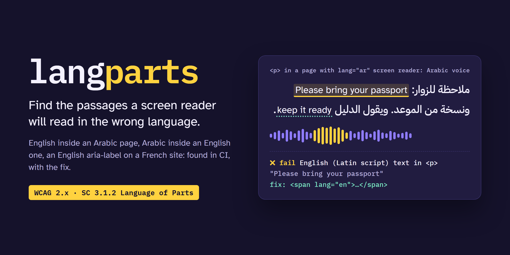

<p align="center">
  
</p>

<p align="center">
  <a href="https://github.com/yahyakhalid/langparts/actions/workflows/ci.yml"></a>
  <a href="LICENSE"></a>
  
  <a href="docs/experiment.md#corpus-b-real-pages"></a>
  
</p>

<p align="center"><b>English</b> · <a href="README.ar.md">العربية</a></p>

<p align="center">
  <a href="https://github.com/topics/accessibility"><code>#accessibility</code></a>
  <a href="https://github.com/topics/a11y"><code>#a11y</code></a>
  <a href="https://github.com/topics/wcag"><code>#wcag</code></a>
  <a href="https://github.com/topics/screen-reader"><code>#screen-reader</code></a>
  <a href="https://github.com/topics/i18n"><code>#i18n</code></a>
  <a href="https://github.com/topics/multilingual"><code>#multilingual</code></a>
  <a href="https://github.com/topics/arabic"><code>#arabic</code></a>
  <a href="https://github.com/topics/rtl"><code>#rtl</code></a>
  <a href="https://github.com/topics/html"><code>#html</code></a>
  <a href="https://github.com/topics/linter"><code>#linter</code></a>
  <a href="https://github.com/topics/sarif"><code>#sarif</code></a>
  <a href="https://github.com/topics/github-actions"><code>#github-actions</code></a>
  <a href="https://github.com/topics/cli"><code>#cli</code></a>
  <a href="https://github.com/topics/nodejs"><code>#nodejs</code></a>
</p>

# langparts

**Find text in another language that has no `lang` attribute, the passages a screen reader will read with the wrong language's rules. WCAG 2.x Success Criterion 3.1.2, Language of Parts.**

## The problem

A screen reader picks its voice and pronunciation from `lang`. When an English sentence sits in an Arabic page, or an English `aria-label` in a French one, without `lang="en"`, it is read with Arabic or French rules and comes out garbled. WCAG 2.x calls this [Success Criterion 3.1.2, Language of Parts](https://www.w3.org/WAI/WCAG22/Understanding/language-of-parts.html) (level AA).

Today this is mostly found by people listening:

- A government accessibility audit of a Canadian sign-in service found an English `aria-label` on a link in the French page and rated it **Serious, WCAG 3.1.2: Fail** ([cds-snc/canadalogin-user-selfservice-webapp#2434](https://github.com/cds-snc/canadalogin-user-selfservice-webapp/issues/2434), opened 2026-10-27). The same repository has sibling findings: [#2436](https://github.com/cds-snc/canadalogin-user-selfservice-webapp/issues/2436), [#2399](https://github.com/cds-snc/canadalogin-user-selfservice-webapp/issues/2399), [#2384](https://github.com/cds-snc/canadalogin-user-selfservice-webapp/issues/2384), [#2387](https://github.com/cds-snc/canadalogin-user-selfservice-webapp/issues/2387), [#2313](https://github.com/cds-snc/canadalogin-user-selfservice-webapp/issues/2313).
- axe-core checks that `lang` values are valid (`html-has-lang`, `valid-lang`), not whether the text matches them. The W3C Nu HTML Checker guesses the language of the whole page (3.1.1), not of its parts.
- A commercial product has the rule: Evinced's ["Language attribute mismatch"](https://knowledge.evinced.com/system-validations/language-attribute-mismatch). It is closed and paid.
- The [WebAIM Million 2026](https://webaim.org/projects/million/) report found that 13.5% of home pages don't declare a page language at all. Nobody publishes a number for 3.1.2, because automated tools don't measure it.

In the research behind this project we did not find an open-source checker for language of parts. langparts is an attempt at one.

## Who it's for

- **Teams running bilingual sites**: Arabic/English, Arabic/Kurdish, French/English, Hebrew/English, government and university sites.
- **Accessibility auditors**, as a first pass before listening with a screen reader.
- **Anyone with HTML in CI**: static sites, documentation, email templates.

## What it does

| | |
|---|---|
| **Script mismatch → fail** | Text in a writing system the declared language doesn't use: English in an Arabic page, Arabic in an English page, Cyrillic, Greek, Hebrew, Chinese, Japanese, Korean, Devanagari, Thai and more |
| **Same script → review** | English in a French page, Persian or Sorani Kurdish in an Arabic page. Never reported as a fail |
| **Names stay quiet** | `GitHub`, `Visual Studio Code`, `iPhone 15 Pro`, `Bank of America`, `António Guterres` in an Arabic page are not reported: WCAG exempts proper names |
| **Accessible names too** | `aria-label`, `aria-description`, `alt`, `title`, `placeholder` and button `value`s, not just visible text |
| **Skips what WCAG allows** | Code (`code`, `kbd`, `samp`, `var`, `pre`), URLs, e-mail addresses, file paths, versions, numbers, `translate="no"`, your ignore list |
| **Respects `lang`** | Inherited `lang`, script subtags (`sr-Latn`, `az-Arab`), `lang=""` as unknown; reports a missing `<html lang>` separately (3.1.1) |
| **Tells you the fix** | `<span lang="en">…</span>`, `<a lang="en">`, or "translate the aria-label" |
| **CI-ready** | Human, JSON and SARIF output (GitHub code scanning), exit codes, a GitHub Action |

## Screenshots

Real output of the CLI on [`examples/`](examples/), rendered from its ANSI colors:

<p align="center"></p>

## Try it

You need Node.js 20.19 or newer.

```bash
npx github:yahyakhalid/langparts page.html
npx github:yahyakhalid/langparts site/                 # every .html, .htm, .xhtml
npx github:yahyakhalid/langparts "dist/**/*.html"
npx github:yahyakhalid/langparts https://example.org/  # static HTML only
```

URLs are fetched as static HTML: **scripts are not run in 0.1**, so text added by JavaScript is not seen. For single-page apps, check the built HTML or save the rendered page first.

### CLI options

| Option | What it does |
|---|---|
| `--lang <tag>` | Page language to assume when `<html>` has no valid `lang` |
| `--min-words <n>` | Words before a foreign-script passage fails (default 3) |
| `--min-chars <n>` | Characters for scripts without spaces: Chinese, Japanese, Thai... (default 6) |
| `--ignore <list>` | Comma-separated names or terms to ignore; repeatable; phrases allowed |
| `--no-review` | Report only fails |
| `--fail-on <level>` | Exit with 1 on `fail` (default), `review` or `none` |
| `--json` / `--sarif` | Machine-readable output |
| `--config <path>` | Config file (default `./langparts.config.json` if it exists) |
| `--no-color` | No colors (`NO_COLOR` is respected too) |

Exit codes: `0` nothing at the `--fail-on` level, `1` findings at that level, `2` bad arguments or an input that could not be read.

`langparts.config.json`:

```json
{
  "lang": "ar",
  "minWords": 3,
  "ignore": ["Acme Cloud", "the quick sync tool"],
  "failOn": "fail"
}
```

### GitHub Actions

```yaml
permissions:
  contents: read
  security-events: write   # for the SARIF upload
steps:
  - uses: actions/checkout@v4
  - uses: yahyakhalid/langparts@main   # pin a commit SHA or a release tag
    with:
      paths: site
      sarif: langparts.sarif
  - uses: github/codeql-action/upload-sarif@v3
    if: always()
    with:
      sarif_file: langparts.sarif
```

Inputs: `paths`, `fail-on`, `sarif`, `args`. The action installs Node 22 with `actions/setup-node`. Full example: [`examples/github-workflow.yml`](examples/github-workflow.yml). Without the action: `npx --yes github:yahyakhalid/langparts site`.

## How it differs from the alternatives

| | Finds untagged text in another language | Same-script languages (EN in FR) | Accessible names | Suggests the fix | Open source | CI / SARIF |
|---|---|---|---|---|---|---|
| **langparts** | ✅ script mismatch as fail | review only | ✅ | ✅ | ✅ MIT | ✅ |
| axe-core `valid-lang`, `html-has-lang` | ❌ checks `lang` values only | ❌ | ❌ | ❌ | ✅ | ✅ |
| W3C Nu HTML Checker | ❌ whole page only (3.1.1), a warning | page level | ❌ | ❌ | ✅ | partly |
| Evinced "Language attribute mismatch" | ✅ (method not documented) | unknown | unknown | unknown | ❌ paid | ✅ |
| Listening with a screen reader | ✅ | ✅ | ✅ | ❌ | — | ❌ |

Based on each product's documentation as of 2026-10-29; we did not test Evinced.

## Use it as a library

```bash
npm install github:yahyakhalid/langparts
```

```js
import { checkHtml, toSarif } from 'langparts';

const { documentLang, findings } = checkHtml(html, { ignore: ['Acme Cloud'] });
for (const f of findings) {
  console.log(f.severity, f.selector, f.attribute ?? '', f.text, '->', f.fix);
}
```

| Function | Returns |
|---|---|
| `checkHtml(html, options?)` | `{ documentLang, assumedLang, findings, stats }`. Options: `lang`, `minWords`, `minChars`, `minReviewWords`, `review`, `franc`, `ignore`, `builtinIgnore` |
| `toSarif(results, { version }?)` | A SARIF 2.1.0 log from `[{ file, findings }]` |
| `parseLang(tag)` | `{ tag, primary, scripts, valid, unknown }` |

Each finding has `rule` (`foreign-script`, `language-mismatch` or `missing-document-lang`), `severity` (`fail` or `review`), `confidence`, `wcag`, `message`, `selector`, `line`, `column`, `attribute`, `text`, `context`, `declaredLang`, `detectedScript`, `detectedLang` and `fix`. Types: [`index.d.ts`](index.d.ts).

## How it works

1. Parse the HTML with [parse5](https://github.com/inikulin/parse5) (the WHATWG algorithm, with source positions) and walk it, keeping the nearest `lang` for every piece of text. Skip scripts, styles, templates, hidden content, code and SVG text (except `<title>`/`<desc>`).
2. Group text into blocks (paragraph, heading, list item, cell, button, link...) and take accessible-name attributes as blocks of their own.
3. Blank out URLs, e-mail addresses, paths and ignored phrases; split the rest into words and split words where the script changes.
4. **Script tier.** Find runs of words in scripts the declared language doesn't use. A run ends where the script changes or at text in the page's own script. For cased scripts, a run fails when it has at least 3 words and 2 of them start with a lower-case letter and aren't name particles (`of`, `de`, `von`...): "Sign in to your account" fails, "Bank of America" doesn't. A whole accessible name needs 2 words. Scripts without case (Arabic, Hebrew...) fail at 3 words; scripts without spaces at 6 characters. Shorter runs are reviews or nothing.
5. **Same-script tier.** Split text into sentences and count function words of each language that uses the same script ("the", "your" vs "le", "votre"). A sentence is a review only when another language clearly wins and the declared language has almost no hits. Long passages in languages without a word list go to [franc](https://github.com/wooorm/franc), and a word list must agree.
6. Report the lowest element that holds the passage, its source position, and a fix.

## Verified results

Criteria were written down before any detection code ([docs/experiment.md](docs/experiment.md), first commit).

| Check | Result |
|---|---|
| Fails on 19 real pages (Arabic, French, English, Persian, Kurdish, Hebrew, Russian, Japanese): hand-labelled precision | **97.4%** (266 of 273 labelled fails) |
| Sentences injected into those pages, found as fails | **86 / 86** |
| English injected into French pages and French into English pages, found as reviews | **25 / 25** |
| Review findings on real pages, random sample of 60: precision | **93.3%** (56 / 60) |
| Labelled corpus: script-tier precision / recall | 100% / 100% (first run, before tuning: 97.5% / 100%) |
| Brand names and proper names in Arabic and French pages reported as fail | **0** of 38 |
| Bilingual Government of Canada pages (FR/EN) | 0 fails, 0 reviews |
| Speed, real pages | about 13–28 MB/s; a 2.5 MB Wikipedia article in 0.15 s |
| Tests | 119 passing (`node --test`) |

How the labels were decided, which false alarms remained, and a labelling choice that would lower 97.4% to 93.4%: [docs/experiment.md](docs/experiment.md). Speed: [docs/benchmarks.md](docs/benchmarks.md).

## Limitations

- **Experimental (0.1).** Rules, options and output may change before 1.0.
- **Static HTML only.** No JavaScript rendering, no CSS: text hidden with CSS is still checked, text added by scripts is not.
- **Names written in lower case can fail.** Lower-case product names ("pandas"), technical terms ("pull request") and transliterations look like phrases. Add them to `--ignore`.
- **Same-script detection is narrow.** Word lists exist for English, French, Spanish, German, Italian, Portuguese, Dutch, Russian, Ukrainian, Arabic, Persian, Sorani Kurdish and Urdu; about 30 more Latin and Cyrillic languages are covered by n-grams for long passages only. Two-word phrases are not judged.
- **Not every script pair is distinguished.** Chinese text inside a Japanese page (both use Han) is not detected; Japanese inside Chinese is detected only through its kana.
- **SVG `<text>` is not checked** (chart labels are mostly names, numbers and units); SVG `<title>` and `<desc>` are.
- **`xml:lang` without `lang` has no effect on HTML elements**, as in browsers; langparts reports it rather than trusting it.
- **The measurements are small.** 19 real pages, labelled by one person. The GitHub Action has not yet been run on GitHub.

## Roadmap

- An axe-core custom rule, so it runs where axe already runs.
- A rendered-page mode (Playwright) for pages built by JavaScript.
- More word lists (Turkish, Indonesian, Hindi...) and more real-page measurements, especially for Kurdish, Persian and Hebrew sites.
- A browser bookmarklet that highlights findings on the page.

## Contributing

False positives and misses help most: open a **False positive or missed passage** issue with the HTML. See [CONTRIBUTING.md](CONTRIBUTING.md). Security issues: [SECURITY.md](SECURITY.md).

## License

[MIT](LICENSE) © Yahya Khalid. Uses [parse5](https://github.com/inikulin/parse5) (MIT), [entities](https://github.com/fb55/entities) (BSD-2-Clause) and [franc](https://github.com/wooorm/franc) (MIT).
